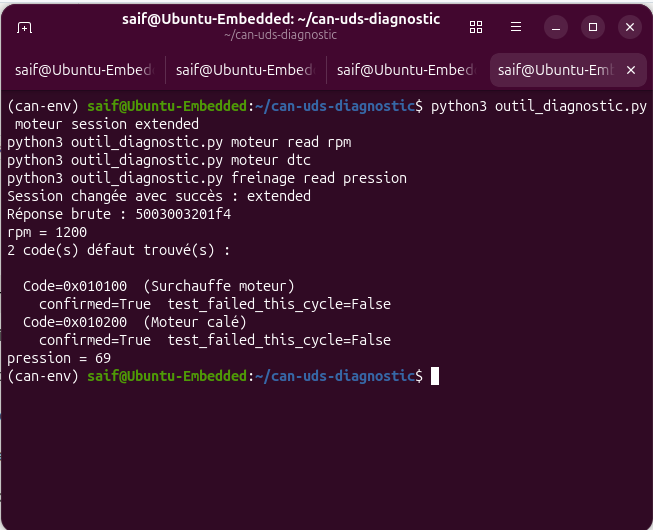

# CAN Bus / UDS Diagnostic Simulator

🇬🇧 [English](#english) · 🇫🇷 [Français](#français)

Simulation of an automotive CAN network (2 ECUs) with a full UDS (ISO 14229) diagnostic client — SocketCAN, ISO-TP, DBC-based frame encoding, 48 unit tests, CI/CD.

---

## English

### Why this project

Built as a portfolio project to demonstrate practical knowledge of the communication and diagnostic protocols used daily in automotive embedded software (CAN, UDS/ISO 14229) — the kind of stack found in ECU development and diagnostic tooling roles at companies like Bosch, Continental, ZF or Hella.

### Architecture
